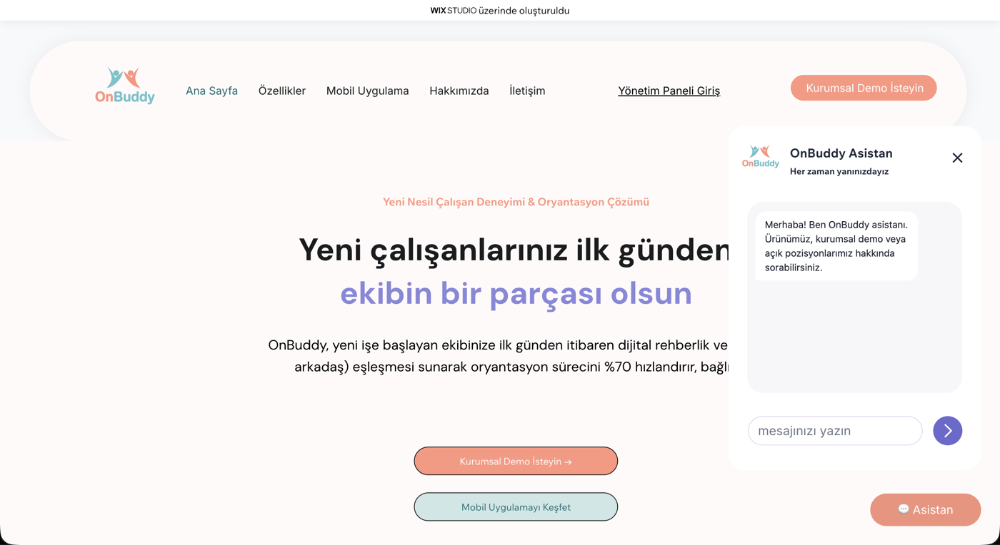
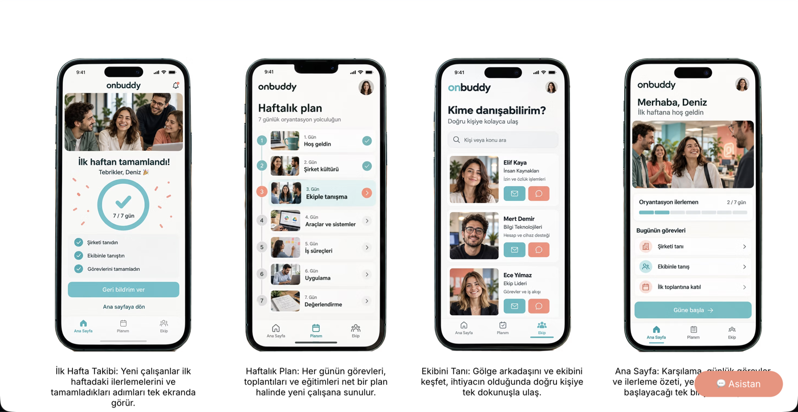
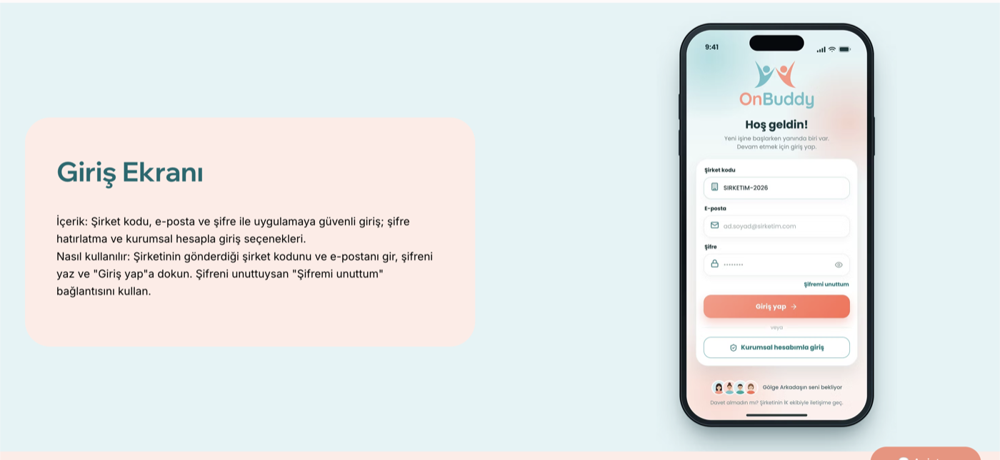
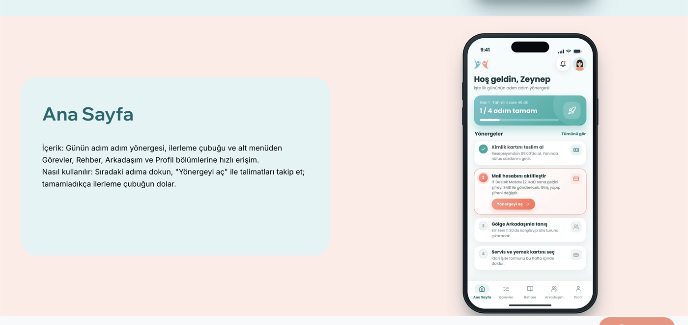
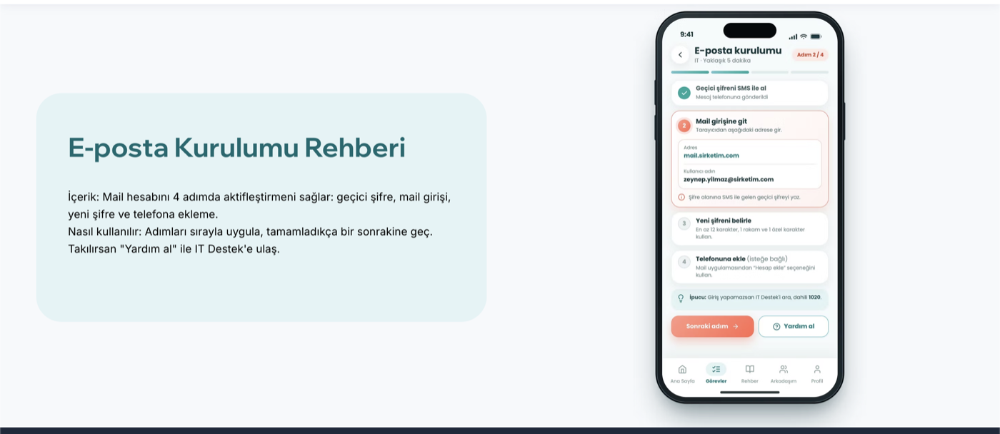

# OnBuddy

OnBuddy, yeni işe başlayan çalışanların oryantasyonunu dijital rehberlik ve "buddy" (gölge arkadaş)
eşleşmesiyle yöneten bir platformdur. Bu depo, platformun tanıtım sitesinin arkasındaki
**backend**'i içerir: sitedeki sohbet asistanına cevap verir ve formdan gelen kayıtları saklar.



Site Wix Studio'da hazırlandı; asıl iş burada, Python ile yazılmış küçük bir Flask uygulamasında dönüyor.

## Mimari

Sistem üç parçadan oluşur: Wix'te duran site, Render'da çalışan bu backend ve cevapları üreten
yapay zekâ servisi (Groq, yedek olarak Gemini). Ziyaretçi yalnızca Wix sitesini görür; site, arka planda backend'e istek atar,
backend de gerekirse yapay zekâ servisine (önce Groq, olmazsa Gemini) sorar.

| Parça | Ne yapar |
|---|---|
| **Wix sitesi** | Ziyaretçinin gördüğü her şey. Sohbet kutusu, iletişim formu ve şifreli yönetim paneli burada. Backend'e `fetch` ile istek atar. |
| **Flask backend** (bu depo) | İstekleri doğrular, yapay zekâya sorar, form kayıtlarını SQLite'a yazar. |
| **Groq** (ana) ve **Gemini** (yedek) | Soruyu alır, verdiğimiz kurallara ve bilgi belgesine bakarak Türkçe cevap yazar. Groq'tan cevap alınamazsa Gemini yazar. |

Backend'in kendi içinde bir bilgi klasörü ve bir veritabanı vardır: `knowledge/` klasörü asistanın
kurallarını ve bilgisini, SQLite veritabanı ise form kayıtlarını (`leads`) ve token kullanımını
(`ai_kullanim`) tutar.

### Bir sohbet mesajı nasıl ilerler?

1. Ziyaretçi sohbet kutusuna bir soru yazar (ör. "Demo nasıl alabilirim?").
2. Wix sitesi, mesajı ve önceki konuşmayı `POST /api/sohbet` adresine gönderir.
3. Backend mesajı doğrular (boş mu, çok uzun mu) ve IP başına istek sınırına ve günlük token bütçesine bakar.
4. Backend, yapay zekâya (önce Groq) şunları gönderir: `asistan.md` (kurallar ve bilgi), sohbet geçmişi ve yeni soru.
5. Model cevabı yazar. Groq'tan geçerli cevap gelmezse aynı istek Gemini'ye gider. Cevap bir form önerecekse sonuna `[FORM:demo]` veya `[FORM:basvuru]` ekler.
6. Backend bu etiketi cevaptan siler, token kullanımını veritabanına yazar ve Wix'e
   `{cevap, yonlendirme}` döner.
7. Wix cevabı sohbet kutusunda gösterir; `yonlendirme` doluysa ilgili form butonunu da çıkarır.

Önemli nokta: asistan **sadece `knowledge/asistan.md` içindeki `<bilgi>` bölümüyle** cevap verir. Belgede olmayan
bir şeyi (fiyat, entegrasyon, maaş vb.) uydurmaması için kurallar aynı dosyanın başında yazılı.

## Klasör yapısı

```
run.py                  Uygulamanın giriş noktası (Render: gunicorn run:app)
config.py               Tüm ayarlar; .env dosyasından okunur
app/
├── __init__.py         Uygulamayı kurar: ayarlar, CORS, veritabanı, bilgi dosyaları, rotalar
├── routes.py           API adresleri; sadece gelen isteği doğrular ve ilgili yere yönlendirir
├── database.py         Veritabanı sorgularının TAMAMI burada (başka yerde SQL yok)
├── services/
│   ├── sohbet_service.py     Sohbetin akışı: bütçe kontrolü → yapay zekâ → kayıt → form yönlendirmesi
│   ├── ai_service.py         Groq ve Gemini ile konuşan tek dosya (yedek sağlayıcı, hata durumları)
│   ├── knowledge_service.py  asistan.md dosyasını okur
│   └── hiz_siniri.py         IP başına istek sınırı
└── templates/          Basit karşılama ve yönetim paneli sayfaları
knowledge/
└── asistan.md          Asistanın tek belgesi: rolü, üslubu, kuralları ve bilgisi (ürün, şirket, kariyer)
scripts/                Gerçek yapay zekâ ile çalışan 24 soruluk elle test
tests/                  Otomatik testler (yapay zekâya gitmez)
docs/                   Görseller ve ilk Wix kod örnekleri
```

Katmanların sınırı bilinçli çizildi: rotalar iş yapmaz, `ai_service.py` yalnızca Groq ve Gemini'yi bilir,
`database.py` yalnızca SQL'i bilir. Bir şeyi değiştirmek istediğinde nereye bakacağın belli olsun diye.

## Yapay zekâ nasıl çalışıyor?

1. Sistem mesajı tek dosyadır: `asistan.md`. Başında kurallar ve üslup, sonunda `<bilgi>` etiketleri arasında
   bilgi vardır. Dosya parçalanmaz ve aranmaz; **tamamı her soruda** modele gönderilir.
2. Ana model Groq'taki `openai/gpt-oss-20b`'dir. Groq'tan geçerli cevap alınamazsa (kota, zaman aşımı, sunucu
   hatası, geçersiz anahtar, boş veya yarım cevap) aynı istek yedek olan Gemini'ye (`gemini-3.5-flash-lite`) gider.
   Sıra `AI_PROVIDER_ORDER` ile değişir; anahtarı olmayan sağlayıcı atlanır. Tüm denemeler `AI_TOTAL_TIMEOUT`
   (25 sn) içinde biter. Başarısız her deneme de `ai_kullanim` tablosuna yazılır, böylece Groq'un ne sıklıkla
   düştüğü görülür. Not: mesajlar yedek durumda Google'a da gider.
3. Cevap kısa ve düz metin olmalıdır. Model, form önermek istediğinde cevabın sonuna `[FORM:demo]` veya
   `[FORM:basvuru]` yazar. Backend bu etiketi cevaptan siler ve Wix'in göstereceği buton için
   `yonlendirme` alanına çevirir.
4. Her çağrının token sayısı `ai_kullanim` tablosuna yazılır (mesaj içeriği yazılmaz). Günlük
   bütçe dolarsa yapay zekâya hiç gidilmez.

**Bilgiyi güncellemek için** `knowledge/asistan.md` içindeki `<bilgi>` bölümünü düzenlemek yeterli. Değişiklik canlıya GitHub
üzerinden gider. Belge her soruda gönderildiği için uzunluğu token harcar; 15.000 karakteri aşarsa
uygulama açılırken uyarı yazar. Dosyada `<!-- ... -->` içine yazdığın notlar modele gönderilmez.

> `asistan.md` içindeki kariyer bölümü ve açık pozisyon listesi şimdilik örnek (mock) veridir.

## Mobil uygulama

Platformun diğer yarısı, çalışanın kullandığı mobil uygulamadır. Bu depoda uygulamanın kodu yoktur;
asistan ve site bu ekranları tanıtır. Başlıca ekranlar:



| Giriş ekranı | Ana sayfa | E-posta kurulumu rehberi |
|---|---|---|
|  |  |  |

## API

| Metot | Adres | Gönderilen | Dönen |
|---|---|---|---|
| POST | `/api/sohbet` | `mesaj` (en çok 1000 karakter), `gecmis` | `basari`, `cevap`, `yonlendirme` (`demo_formu`, `basvuru_formu` veya `null`) |
| POST | `/api/leads` | `isim`, `telefon`, `eposta?`, `pozisyon?`, `mesaj?` | `basari`, `mesaj` |
| GET | `/api/leads` | `X-Admin-Token` başlığı | `basari`, `toplam`, `leadler` |
| GET | `/health` | | `durum: "aktif"` |

Hata durumunda `{"basari": false, "hata": "..."}` döner: hatalı istek 400, çok büyük istek 413, çok
fazla istek veya Groq kotası 429, yapay zekâ servisi hatası 503.

Terminalden denemek için:

```bash
curl -s -X POST https://onbuddy-f3hp.onrender.com/api/sohbet \
  -H "Content-Type: application/json" \
  -d '{"mesaj": "Demo nasıl alabilirim?"}'
```

## Yerelde çalıştırma

```bash
python3 -m venv venv
source venv/bin/activate                 # Windows: venv\Scripts\activate
pip install -r requirements.txt
cp .env.example .env                     # sonra .env içine GROQ_API_KEY (ve istersen GEMINI_API_KEY) yaz
python run.py
```

Uygulama http://localhost:5000 adresinde açılır. İki anahtar da boşsa sistem demo modunda çalışır
ve gerçek cevap vermez.

## Testler

```bash
pip install -r requirements-dev.txt
python -m pytest -q                 # otomatik testler, yapay zekâya gitmez
python -m scripts.degerlendir       # 24 soruluk elle test, gerçek API anahtarı ister
python -m scripts.degerlendir --saglayici gemini   # yedeği tek başına ölçmek için
```

## Güvenlik ve koruma

- SQL sorgularında `?` yer tutucusu kullanılır (SQL injection'a karşı).
- API anahtarları ve şifreler `.env` dosyasında durur; `.gitignore` bunu GitHub'a göndermez.
- CORS ayarıyla yalnızca bizim Wix sitemizin API'ye istek atmasına izin verilir (`CORS_ORIGINS`).
- `ADMIN_TOKEN` tanımlıysa aday listesi (`GET /api/leads`) o anahtar olmadan açılmaz; canlıda mutlaka tanımlanmalı. Wix'teki yönetim paneli de ayrıca şifreyle korunur.
- Sohbet ve form için IP başına istek sınırı vardır; günlük toplam token bütçesi de sınırlıdır.
- Mesaj içerikleri veritabanına yazılmaz, yalnızca token sayıları tutulur.

## Yayınlama (Render)

- Build komutu: `pip install -r requirements.txt`
- Başlatma komutu: `gunicorn run:app`
- Ortam değişkenleri: `FLASK_ENV=production`, `GROQ_API_KEY`, `GEMINI_API_KEY`, `SECRET_KEY`, `CORS_ORIGINS`, `ADMIN_TOKEN`
  (tüm ayarlar ve varsayılanları `.env.example` içinde)
- `main` dalına birleşen her değişiklik Render'da otomatik yayınlanır.

Render'ın ücretsiz planında disk kalıcı değildir; sunucu yeniden başladığında `onbuddy.db` silinir ve
kayıtlı adaylar kaybolur. Kalıcı veri için ücretli planda kalıcı disk eklenip `DATABASE_URL` o diske
yönlendirilmelidir.

## Wix tarafı

Sohbet kutusu, form ve yönetim paneli Wix Studio içinde, Velo koduyla çalışır ve bu backend'e istek atar.
`docs/wix_karsilama.js` ve `docs/wix_panel.js` bu bağlantının ilk sürüm örnekleridir; sitenin güncel
kodu Wix editöründedir.
